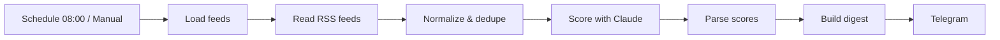

# n8n Job Scout

> An **n8n** workflow that collects job offers from RSS feeds, scores them against your profile with **Claude**, and sends you a daily **Telegram** digest of the best matches.


## Why this project

Job alerts arrive from many sources, are full of duplicates and mostly irrelevant. This workflow does the first reading for you: it gathers offers, removes noise and asks an LLM to rank them against a written professional profile, so you only review the few that really fit.

## Features (v0.1)

- **RSS ingestion** from any number of job-board feeds (`config/feeds.txt`)
- **Normalisation** into a common offer shape (title, company, location, link, plain-text description)
- **Deduplication** across runs with a 30-day memory, using n8n workflow static data
- **LLM scoring with Claude** via the Messages API: 0–100 fit score, reasons, red flags, seniority fit and remote compatibility
- **Versioned prompt** with strict JSON output and defensive parsing (the workflow never crashes on a bad model answer)
- **Daily Telegram digest**, sorted by score and kept under Telegram's message limit
- **Cost control**: maximum offers per run and request batching
- **Tested code**: the JavaScript inside every Code node is generated from `src/` and covered by unit tests plus an end-to-end test that executes the real node code

## Architecture



## Prompt design

The scoring prompt (`prompts/score-offer.md`) gives the model the candidate profile and the offer, applies deal breakers strictly and requires a JSON-only answer:

```json
{
  "score": 0,
  "match_reasons": ["..."],
  "red_flags": ["..."],
  "seniority_fit": "under | fit | over",
  "remote_ok": true
}
```

The response is validated before use: scores are clamped to 0–100, lists are capped and any malformed answer is marked as an error and retried on the next run.

## Repository structure

```text
.
├── workflows/job-scout.json   # Generated n8n workflow (import this)
├── src/                       # Logic used inside the Code nodes
│   ├── config.js              # Feed list parsing
│   ├── normalize.js           # Normalisation and deduplication
│   ├── score.js               # Prompt filling, request body, response parsing
│   └── digest.js              # Telegram digest
├── scripts/build-workflow.js  # Builds the workflow JSON from src/
├── test/                      # node:test unit and workflow tests
├── prompts/score-offer.md     # Versioned scoring prompt
├── config/                    # profile.example.md, feeds.example.txt
├── docker-compose.yml         # Self-hosted n8n
├── .env.example
└── docs/setup.md
```

## Getting started

```bash
git clone https://github.com/xavieroldan/n8n-job-scout.git
cd n8n-job-scout
cp .env.example .env
cp config/profile.example.md config/profile.md
cp config/feeds.example.txt config/feeds.txt
docker compose up -d
```

Then open http://localhost:5678, import `workflows/job-scout.json` and add the Anthropic and Telegram credentials. Full guide: [docs/setup.md](docs/setup.md).

## Development

```bash
npm test        # 19 tests, no dependencies required
npm run build   # regenerate the workflow from src/
npm run check   # verify the committed workflow is up to date (CI)
```

## Responsible use

- Uses **feeds you subscribe to**; it does not scrape sites that forbid it in their terms.
- API keys live in n8n credentials and personal data in git-ignored files; nothing sensitive is committed.

## Tech stack

n8n · Claude API (Anthropic) · Prompt engineering · Telegram Bot API · Docker Compose · Node.js (node:test) · GitHub Actions

## Roadmap

- [x] RSS ingestion
- [x] Normalisation and deduplication
- [x] Claude scoring with structured output
- [x] Telegram digest
- [x] Docker Compose setup and documentation
- [x] Tests and CI
- [ ] Email job-alert ingestion (IMAP)
- [ ] Google Sheets log of every offer and score
- [ ] Weekly summary with trends (roles, locations, salary ranges when available)

## What this project demonstrates

- Designing **AI-powered automations** with n8n
- **Prompt engineering** with structured, validated outputs
- Treating low-code workflows like code: **generated from source, tested and checked in CI**

## Author

**Xavier Roldán** — Senior Developer & Team Lead
[xavierroldan.com](https://xavierroldan.com) · [LinkedIn](https://www.linkedin.com/in/xavierroldan/)

## License

MIT
